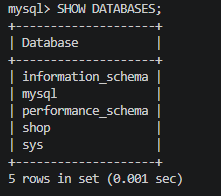
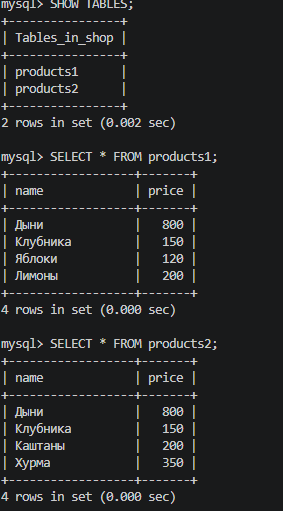
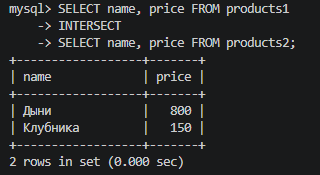
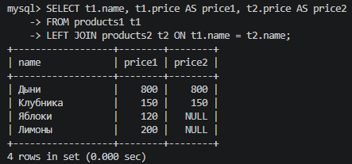
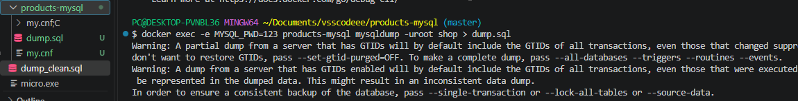
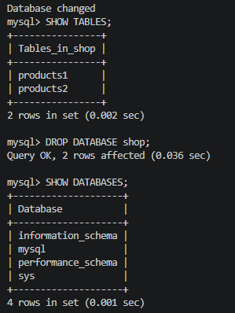
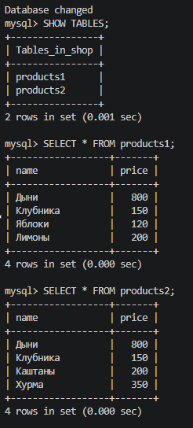

# Лабораторная работа №3: Основные SQL-операции над множествами

## Цель работы
Изучение базовых операций реляционной алгебры (выборка, проекция, объединение, разность, пересечение, декартово произведение, соединение) на примере двух таблиц.

## Ход работы
1. Создан контейнер `products-mysql` и база данных `shop`.
2. Созданы таблицы `products1` и `products2`, заполнены данными.
3. Выполнены основные операции:
   - Выборка (`WHERE`)
   - Проекция (`SELECT name`)
   - Объединение (`UNION`)
   - Разность (`EXCEPT`)
   - Пересечение (`INTERSECT`)
   - Декартово произведение (`CROSS JOIN`)
   - Соединение (`JOIN` и `LEFT JOIN`)
4. Создан дамп базы данных (`dump_clean.sql`).
5. База данных удалена и успешно восстановлена из дампа.

## Скриншоты

## Создание БД

## Таблицы и данные

## Операция EXCEPT

## Операция LEFT JOIN

## Файл дампа

## Удаление БД

## Восстановление БД

## Результаты
В папке проекта находятся:
- `dump_clean.sql` — резервная копия базы данных `shop`.